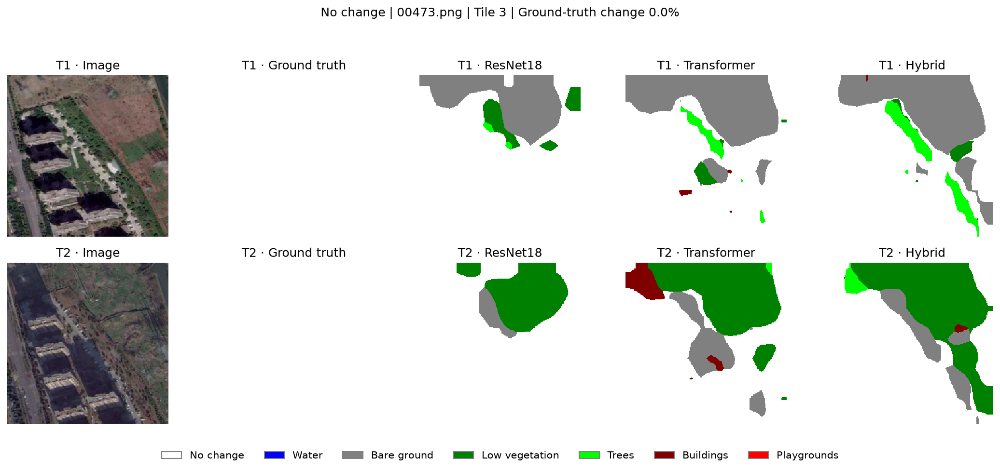

# TerraMind

TerraMind compares three Siamese architectures for semantic change detection in paired satellite images from the [SECOND dataset](https://captain-whu.github.io/SCD/). Each model predicts where land cover changed and the classes before and after the change.

## Results

Siamese Transformer achieved the highest F1-SCD (**0.4414**) and SeK (**0.0653**) on the TerraMind validation split. Siamese ResNet18 had the lowest median GPU forward latency (**2.88 ms**).

| Model | Binary Change F1 | F1-SCD | SeK | Parameters | Median / P95 latency | Peak extra GPU memory | Training time |
|---|---:|---:|---:|---:|---:|---:|---:|
| Siamese ResNet18 | 0.5642 | 0.3922 | 0.0192 | 12.36M | **2.88 / 3.50 ms** | 59.8 MiB | 32.1 min |
| Siamese Transformer | **0.5858** | **0.4414** | **0.0653** | **2.42M** | 5.46 / 7.66 ms | **13.7 MiB** | **28.4 min** |
| Hybrid CNN–Transformer | 0.5647 | 0.4250 | 0.0595 | 5.10M | 8.00 / 12.38 ms | 30.9 MiB | 31.1 min |

Latency is GPU forward time per image pair on an RTX 4060 Laptop GPU with batch size 1, FP32, 30 warmup passes, and 100 timed passes. Inputs were already on the GPU.

Peak extra memory measures PyTorch allocations for the model and forward pass above the pre-model baseline. Training time is the sum of the three training epochs, excluding validation.

## Dataset

This project uses the **SECOND (SEmantic Change detectiON) Dataset**, a remote sensing dataset for semantic change detection.

The dataset contains paired satellite images captured at two different timestamps, along with corresponding semantic segmentation labels.

### Download Dataset

The dataset is not included in this repository due to its large size.

**[Download SECOND Dataset — Official Website](https://captain-whu.github.io/SCD/)**

Visit the official website to access the dataset download links.

### Dataset Directory Structure

After downloading and extracting the SECOND training dataset, organize the files as follows:

```text
data/
└── raw/
    └── SECOND_train_set/
        ├── im1/
        ├── im2/
        ├── label1/
        └── label2/
```

- `im1/`: Satellite images at timestamp T1.
- `im2/`: Satellite images at timestamp T2.
- `label1/`: Semantic segmentation labels for T1.
- `label2/`: Semantic segmentation labels for T2.

**Note:** The entire `data/` directory is excluded from Git version control using `.gitignore`. Users must download the dataset separately before running the experiments.

## Experiment

- Split 2,968 labeled image pairs by filename with seed 42 before cropping. The split contains 2,374 training pairs and 594 validation pairs.
- Crop each 512 × 512 pair into four aligned 256 × 256 patches. Each timestamp has a seven-class target with class 0 representing no annotated change.
- Train from scratch for three epochs per model with batch size 4, AdamW at 0.001, and weighted cross-entropy.
- Class weights come from the training masks and are proportional to the inverse square root of class frequency counts.
- Score the epoch-3 checkpoints on the same validation split.
- Binary Change F1 combines the two timestamps with a logical OR.
- F1-SCD and SeK use the pooled per-timestamp confusion matrix following [Bi-SRNet](https://github.com/DingLei14/Bi-SRNet/blob/main/utils/utils.py#L190-L222).

## Error Analysis



All three models marked some pixels as changed in this patch, while the reference masks mark the whole patch as unchanged.

The [small-change example](outputs/figures/small_changed_area_01610_tile1.png) shows missed building regions.

The [large-change example](outputs/figures/large_changed_area_07341_tile3.png) shows partial recovery of vegetation-to-bare-ground changes and some spurious building predictions.

## Local Setup

### 1. Clone Repository

```bash
git clone https://github.com/IttikornMafaka/Terramind-second-Benchmark.git
cd TerraMind
```


### 2. Install Dependencies

The project uses Python 3.11 and `uv` for dependency management.

```bash
uv sync
```

Select the project's Python 3.11 environment or notebook kernel.

### 3. Download Dataset

Download the SECOND training dataset from the [official website](https://captain-whu.github.io/SCD/).

Extract the dataset into:

```text
data/raw/SECOND_train_set/
```

Ensure that the directory contains `im1`, `im2`, `label1`, and `label2`.

### 4. Model Checkpoints

Place the locally trained epoch-3 checkpoints under:

```text
outputs/
└── checkpoints/
    ├── resnet18_weighted_epoch3.pt
    ├── transformer_weighted_epoch3.pt
    └── hybrid_weighted_epoch3.pt
```

These checkpoints are not included in the repository and must be available locally to load the trained models.

### 5. Run Experiments

Use [main.ipynb](notebooks/main.ipynb) for the training setup.

The shared implementation is organized into:

- [second_dataset.py](src/datasets/second_dataset.py) — Dataset loading and preprocessing.
- [siamese.py](src/models/siamese.py) — Siamese model architectures.
- `outputs/figures/` — Exported evaluation and visualization figures.

The reported evaluation and benchmark were run interactively. The saved notebooks do not yet provide a complete fresh-kernel reproduction of all reported results.

## Limitations

The comparison uses one local validation split and one three-epoch run per architecture.

Future improvements include:

- Evaluation on the official SECOND test set.
- Repeated experiments with different random seeds.
- Hybrid CNN–Transformer ablation studies.
- Additional training epochs and hyperparameter optimization.
- Improved reproducibility of evaluation and benchmarking.

## Technical Report

For additional details on the architectures, experimental methodology, evaluation metrics, and findings, see the [TerraMind Technical Report](TerraMind_Technical_Report.docx).

## Dataset Reference

SECOND Dataset — [Official Project Website](https://captain-whu.github.io/SCD/)


Yang et al. (2020). *Semantic Change Detection with Asymmetric Siamese Networks*.
